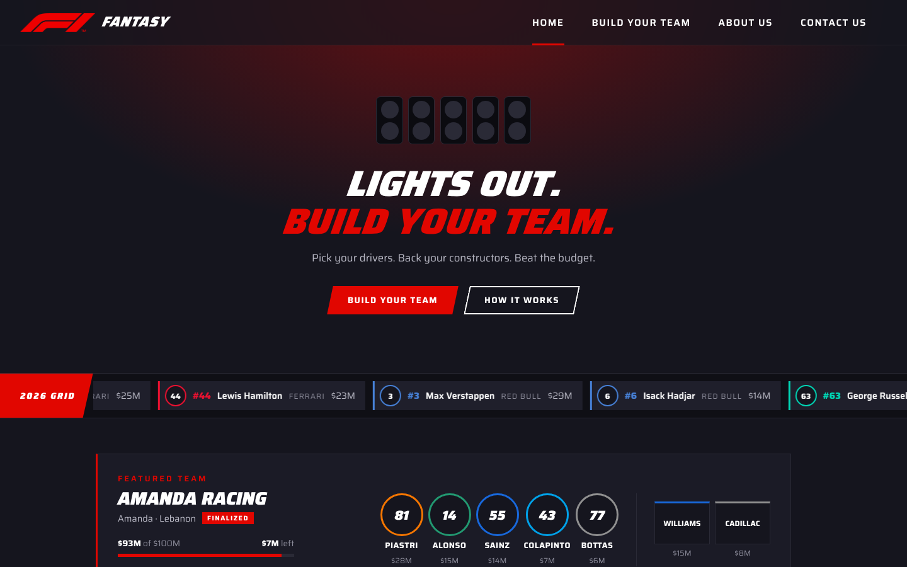
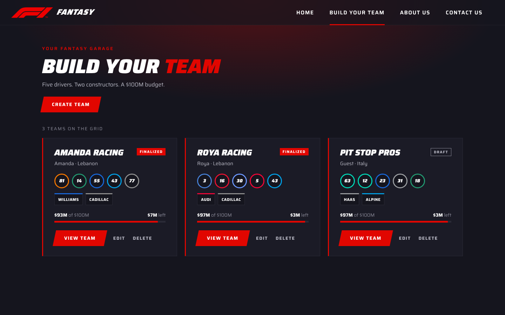
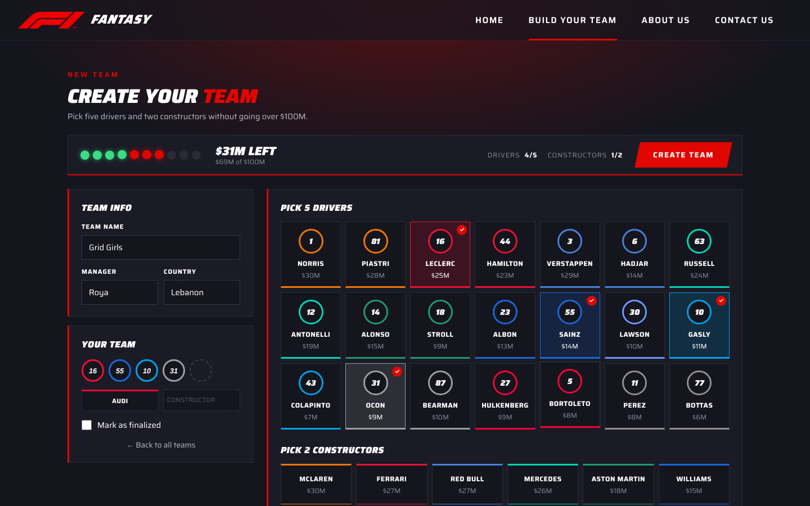
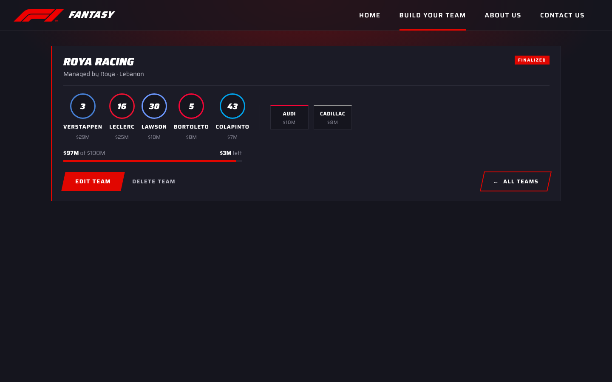
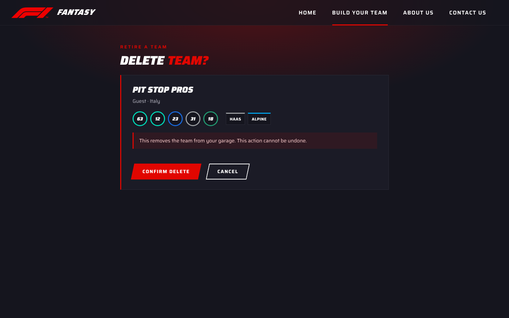
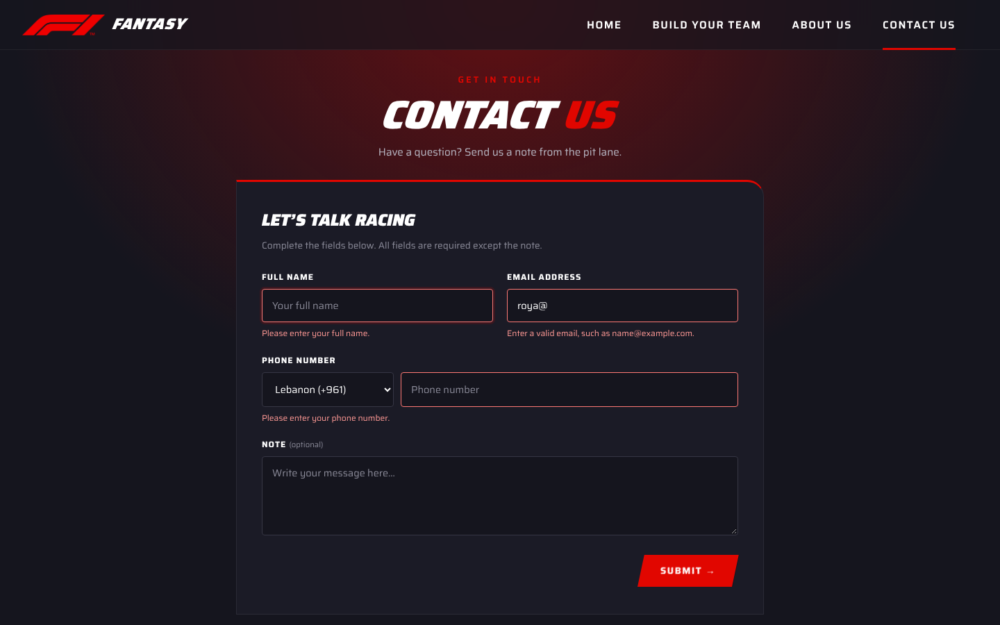
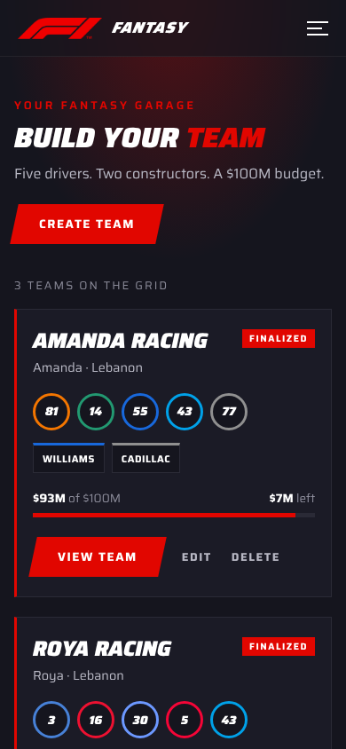
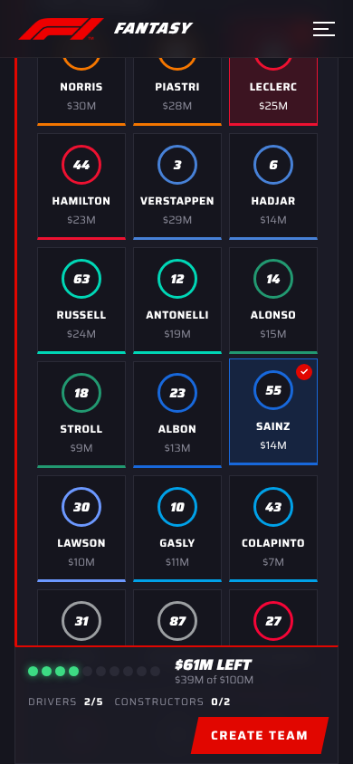

# F1 Fantasy

**Build your dream Formula 1 team: five drivers, two constructors, one $100M budget.**

F1 Fantasy is a full-stack web app made for **CSC457 – Mobile App Development (Project 1)**. It has a **Node.js / Express** web API that manages fantasy teams in memory, and a **React** single-page app where you can browse, create, edit and delete teams from the real 2026 F1 grid.



---

## Contents

- [Features](#features)
- [Screenshots](#screenshots)
- [Tech stack](#tech-stack)
- [Getting started](#getting-started)
- [Web API](#web-api)
- [The Team entity](#the-team-entity)
- [Project structure](#project-structure)
- [How it meets the project requirements](#how-it-meets-the-project-requirements)
- [Authors](#authors)

---

## Features

- **Start-lights home page**: five F1 start lights switch on one by one, then go out to reveal the page, with a live ticker of the 2026 grid and a featured team.
- **Team garage**: every team as a card showing its drivers, constructors and budget.
- **Team builder**: pick 5 drivers and 2 constructors from tiles in their real team colors.
- **Rev-lights budget bar**: a budget bar styled like an F1 steering wheel's shift lights stays pinned at the top while you pick. It goes green, then red, then blue as you spend, and flashes red when you go over $100M.
- **"Too much" hints**: drivers and constructors you can't afford with what's left fade out automatically.
- **Full CRUD**: create, view, edit and delete teams, all through the Web API.
- **Form validation** on both the team builder and the contact form, with a message under each wrong field.
- **Responsive**: works on laptops and phones; on phones the budget bar moves to the bottom of the screen.
- **404 page** for unknown URLs.

---

## Screenshots

### All teams
Every team in the garage, with its line-up and budget.



### Team builder
Team info and your picks on the left, the grid on the right, and the rev-lights budget bar always in view.



### Team details
One team's full line-up, with buttons to edit it, delete it or go back to all teams.



### Delete a team
A confirmation step before anything is removed.



### Contact us
A validated form: each wrong field shows its own message.



### On a phone

| All teams | Team builder |
|:---:|:---:|
|  |  |

> Driver photos come from the official F1 website. If they can't load, each circle shows the driver's number in his team's color instead, as in some of these screenshots.

---

## Tech stack

| Part | Technology |
|---|---|
| Backend | Node.js, Express 5, CORS |
| Frontend | React 19, Vite |
| Routing | React Router 7 |
| State management | Redux Toolkit + React Redux |
| Styling | Plain CSS, Saira font |

---

## Getting started

You need **Node.js** (version 20.19 or newer) installed.

**1. Clone the repository**
```bash
git clone https://github.com/amandaelkik/f1_fantasy.git
cd f1_fantasy
```

**2. Start the backend** (runs on `http://localhost:3000`)
```bash
cd backend
npm install
npm start
```

**3. Start the frontend** in a second terminal (runs on `http://localhost:5173`)
```bash
cd frontend
npm install
npm run dev
```

**4. Open** `http://localhost:5173` in your browser.

> The teams are stored **in memory**, so restarting the backend resets them to the 3 starting teams.

---

## Web API

Base URL: `http://localhost:3000`

| Method | Route | What it does | Responses |
|---|---|---|---|
| `GET` | `/teams` | Get all teams | `200` |
| `GET` | `/teams/:id` | Get one team | `200`, `404` if not found |
| `POST` | `/teams` | Create a team | `201`, `400` if the data is invalid |
| `PUT` | `/teams/:id` | Replace a team | `200`, `400` invalid data, `404` not found |
| `DELETE` | `/teams/:id` | Delete a team | `200`, `404` if not found |
| `GET` | `/drivers` | The 2026 drivers (used to build teams) | `200` |
| `GET` | `/constructors` | The 2026 constructors (used to build teams) | `200` |

**Example: create a team**
```js
fetch('http://localhost:3000/teams', {
  method: 'POST',
  headers: { 'Content-Type': 'application/json' },
  body: JSON.stringify({
    teamName: 'Grid Girls',
    manager: { name: 'Roya', country: 'Lebanon' },
    driverIds: [9, 13, 15, 19, 21],
    constructorIds: [10, 11],
    remainingBudget: 29,
    isFinalized: false
  })
})
```

---

## The Team entity

Each team has **7 properties of different data types**:

| Property | Type | Example |
|---|---|---|
| `id` | Number | `2` |
| `teamName` | String | `"Roya Racing"` |
| `manager` | Object | `{ name: "Roya", country: "Lebanon" }` |
| `driverIds` | Array | `[5, 3, 13, 20, 16]` |
| `constructorIds` | Array | `[10, 11]` |
| `remainingBudget` | Number | `3` (in millions) |
| `isFinalized` | Boolean | `true` |

The backend checks the data types before saving (for example, `teamName` must be a non-empty string). The game rules (exactly 5 drivers, 2 constructors, max $100M) are checked in the frontend, because the brief asks for a backend without business logic.

---

## Project structure

```
f1_fantasy/
├── backend/
│   ├── backend.js        Express server and the CRUD routes
│   ├── data.js           2026 drivers and constructors
│   └── package.json
└── frontend/
    ├── index.html
    ├── package.json
    └── src/
        ├── main.jsx          Redux Provider + React Router
        ├── App.jsx           All the routes
        ├── api/
        │   └── teamsApi.js   The HTTP requests to the backend
        ├── redux/
        │   ├── store.js
        │   └── teamsSlice.js Teams state + async CRUD actions
        ├── components/       Reusable pieces
        │   ├── Navbar.jsx, Footer.jsx
        │   ├── TeamCard.jsx, TeamForm.jsx, TeamLineup.jsx
        │   └── DriverAvatar.jsx, BudgetBar.jsx
        └── pages/            One per route
            ├── Home.jsx, AboutUs.jsx, ContactUs.jsx
            ├── Teams.jsx, TeamDetails.jsx
            ├── CreateTeam.jsx, EditTeam.jsx, DeleteTeam.jsx
            └── NotFound.jsx
```

---

## How it meets the project requirements

| Requirement | Where |
|---|---|
| Node/Express Web API with GET, GET by id, POST, PUT, DELETE | `backend/backend.js` |
| In-memory dataset, entity with 5+ properties of different types | `teams` array in `backend.js` (7 properties) |
| No database, authentication or business logic in the backend | `backend.js` |
| React single-page application | `frontend/` |
| Home, About us, Contact us views | `pages/Home.jsx`, `AboutUs.jsx`, `ContactUs.jsx` |
| Display all / display one / submit / update / delete views | `pages/Teams.jsx`, `TeamDetails.jsx`, `CreateTeam.jsx`, `EditTeam.jsx`, `DeleteTeam.jsx` |
| Components, props and state | `components/` (e.g. `TeamCard` gets a team through props), `useState` in the forms |
| Contact form with event handling and input validation | `pages/ContactUs.jsx` |
| Views use the Web API through HTTP requests | `api/teamsApi.js`, called by `redux/teamsSlice.js` |
| React Router for navigation | `main.jsx`, `App.jsx` |
| Redux for centralized state | `redux/store.js`, `redux/teamsSlice.js` |

| Route | View |
|---|---|
| `/` | Home |
| `/about` | About us |
| `/contact` | Contact us |
| `/teams` | Display all teams |
| `/teams/new` | Submit a new team |
| `/teams/:id` | Display one team |
| `/teams/:id/edit` | Update a team |
| `/teams/:id/delete` | Delete a team |

---

## Authors

Made by **Amanda** and **Roya** for CSC457 – Mobile App Development.
